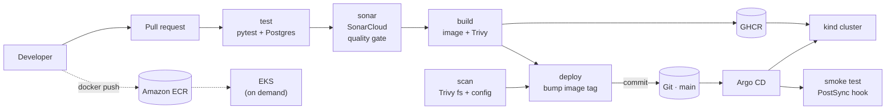

# Harbourline Logistics — Container & Kubernetes Lab

**Plimsoll** — a warehouse management system for Harbourline Logistics, used as
the workload for building, breaking and
operating **three Kubernetes environments**: a local `kind` cluster for GitOps and
application work, a **bare-metal multi-node cluster built from scratch with
kubeadm**, and **Amazon EKS**, stood up and torn down per session.

The application is deliberately small. The interesting part is everything around
it — delivery, storage, networking, policy, observability, and what happens when
each of those breaks.

A fourth, disposable cluster is built **from nothing by Terraform** in four
minutes, to test whether any of this is actually reproducible.

**It is.** A git clone, `terraform apply`, and one key file produce a cluster
that seeds its own database and proves it works by running its own
post-deployment smoke test. Getting there took
[three rebuilds](docs/rebuild-test.md) and found five gaps — the last of which
left every health signal green while the application returned 500 to every
request.

---

### Why Plimsoll

The Plimsoll line is the mark on a ship's hull showing maximum safe loading.
Samuel Plimsoll got it written into law in 1876 to stop owners sending
overloaded ships to sea. A warehouse system is about how much can safely be
held and moved.

Its architecture is modelled on a conventional tier-3 WMS — Portal, middleware,
database with a standby — and
[`docs/wms-architecture.md`](docs/wms-architecture.md) works through what
translates to Kubernetes and what does not. Oracle RAC does not, and saying so
is more useful than a diagram where everything fits.

---

## Environments

| | **kind** `harbourline` | **VM cluster** `harbourline-vm` | **AWS** |
|---|---|---|---|
| Built with | `kind` (Docker, WSL2) | **`kubeadm` v1.37, from scratch** | `eksctl` |
| Nodes | 1 control plane + 2 workers | 3 Hyper-V VMs (Ubuntu 24.04) | managed control plane + 2 × t3.medium |
| CNI | kindnet | **Cilium** | VPC CNI |
| Storage | local-path | **Longhorn** (iSCSI, 2 replicas) | EBS CSI (gp3) |
| Load balancing | Ingress via host ports | **MetalLB L2** → Traefik | Classic LB |
| Registry | GHCR (pull secret) | — | **ECR (no pull secret — node IAM role)** |
| Purpose | GitOps, apps, policy, logging | what Kubernetes is *made of* | cloud integration |
| Cost | £0 | £0 | **destroyed after every session** |

A fifth environment exists on demand: **`kind-harbourline-tf`**, created by
[`terraform/kind-bootstrap`](terraform/kind-bootstrap/) — a cluster, Argo CD,
and one Application that hands everything else over to GitOps. `terraform
destroy` removes it; `apply` brings it back in four minutes.

Every command names its context explicitly — `--context kind-harbourline`,
`--context harbourline-vm`, `--context kind-harbourline-tf`. The lab cluster is
registered **only in WSL's kubeconfig**; see
[`docs/kind-cluster-access.md`](docs/kind-cluster-access.md).

---

## Delivery pipeline



**Most stages can refuse.** A failing test, a HIGH vulnerability or a
Kubernetes misconfiguration each stop the pipeline — verified by opening a
pull request with a known-vulnerable dependency and watching it blocked,
rather than by assuming.

**SonarCloud is advisory, and that is a downgrade.** It blocked until
2026-11-14, when SonarCloud deprecated Security Hotspots and converted them
into Issues — which count toward the Security Rating where Hotspots did not.
A gate that had been green failed on code nobody had touched, and kept failing.
A gate that can turn red without a commit is a gate on the vendor's release
schedule, not on this repository. The analysis still runs and the findings are
still visible; enforcement is gone until the backlog is triaged and a
*project-owned* quality gate replaces the inherited one. See
[`docs/security-decisions.md`](docs/security-decisions.md).

**No cluster credentials exist in CI.** The pipeline's last step is a commit that
bumps an image tag; Argo CD pulls. A compromised runner cannot reach a cluster.

**Every action is pinned to a commit SHA**, not a tag. A tag is a mutable label
the owner can re-point; a SHA is the content.

**The deployment is validated inside the cluster**, not by CI — which holds no
credentials and cannot look. A `PostSync` hook requests `/api/shipments` through
the real front door, so nginx, the API and Postgres are all exercised by one
request. If it fails the Application goes red. It was built because on 12
October the site showed "Loading…" for hours while every health signal stayed
green.

---

## What this demonstrates

**Delivery and configuration**
Helm chart serving three services from one template · Kustomize base for shared
infrastructure · Argo CD app-of-apps with `selfHeal` (measured: reverts live
drift in under 5 seconds) · sync hooks, including the `PreSync`/`Sync`/`PostSync`
distinction learned by deadlocking a sync · migration from Kustomize to Helm
proven byte-identical with `kubectl diff`

**Availability and scaling**
PodDisruptionBudgets · topology spread constraints · HorizontalPodAutoscaler,
and the conflict between an HPA and GitOps both claiming `spec.replicas` ·
rolling updates and rollback · a Deployment→StatefulSet migration that preserved
the live PersistentVolume

**Networking**
Default-deny **ingress and egress** NetworkPolicies, 10 policies, proven in both
directions · MetalLB L2 failover demonstrated with 96 consecutive 200s through a
handover · Traefik as a single front door with TLS termination, HTTP→HTTPS
redirect and BasicAuth · CoreDNS customisation so pods resolve LAN hostnames

**Storage**
Longhorn across dedicated disks, survived a hard power-off as *Degraded, not
Faulted* · EBS CSI on EKS with `WaitForFirstConsumer` · PV reclaim policies and
what `Retain` is actually for

**Testing and delivery gates**
11 pytest tests — unit via Flask's `test_client`, integration against a **real
Postgres** service container rather than a mock, because mocking means the SQL
never runs · a test that asserts a **security property** (`/config` must never
expose the password), verified by deliberately breaking it · SonarCloud analysis
with a **blocking quality gate** · Trivy filesystem, config and image scans, all
**blocking**, with accepted exceptions documented and dated · least-privilege
per-job `permissions`, deny by default

**Security**
All workloads hardened — non-root, read-only root filesystem, dropped
capabilities, seccomp · **Kyverno** admission policies derived from the project's
own security decisions, with one documented, dated exception · Trivy image, fs
and config scanning in CI · Secret encryption at rest · RBAC

**Observability**
kube-prometheus-stack on both clusters, **one Grafana** reading both · Loki +
Alloy for logs · the `up == 0` query that exposes silently-missing scrape targets

**Infrastructure as code**
Terraform builds a cluster, installs Argo CD and hands over — **the boundary is
the design**: Argo CD manages everything *except itself*, because two owners of
one field is permanent drift with both parties correct · provider versions
pinned by committed lock file, not by constraint · a CRD and a custom resource
of that kind cannot be created in one step, learned by walking into it from both
directions · a **rebuild test** that turned "we use GitOps" into four named,
measured gaps

**Cloud**
Full `Developer → image → ECR → EKS → Load Balancer → Application` flow, verified
end to end · IRSA · a `teardown-check.sh` that fails loudly if anything is still
billing

---

## Repository layout

```
api/  web/  reports/     three services, each with a Dockerfile
helm/harbourline/        one chart, three values files
k8s/base/                Kustomize: db, config, ingress, NetworkPolicies
k8s/argocd/              Argo CD Applications (app-of-apps)
k8s/platform/            kind cluster Ingresses (Grafana, Argo CD)
k8s/monitoring/          kube-prometheus-stack, Loki, cross-cluster datasource
k8s/policies/            Kyverno ClusterPolicy
k8s/kind/                CoreDNS customisation (applied by hand, not by Argo)
k8s/vm-cluster/          MetalLB, Longhorn, Traefik, platform Ingresses
k8s/eks/                 eksctl ClusterConfig, app manifests, teardown check
k8s/labs/rbac/           RBAC labs and a privileged-permission audit
terraform/kind-bootstrap/  a cluster + Argo CD, from nothing, in four minutes
docs/                    architecture, security decisions, runbooks
tools/                   node prep, a kubectl plugin, a network probe
```

---

## Access

| Service | URL | Cluster |
|---|---|---|
| Application | `http://harbourline.localtest.me` | kind |
| Grafana (both clusters) | `http://grafana.localtest.me` | kind |
| Argo CD — applications | `http://argocd.localtest.me` | kind |
| Argo CD — VM platform | `https://argocd.hl.internal` | VM |
| Longhorn | `https://longhorn.hl.internal` | VM |
| Prometheus | `https://prometheus.hl.internal` | VM |
| Argo CD — Terraform lab | `http://localhost:8080` (port-forward) | `kind-harbourline-tf` |

`*.hl.internal` resolves through the workstation's hosts file **and** the kind
cluster's CoreDNS — browsers and pods are different clients and resolve
differently. See [`docs/vm-cluster-access.md`](docs/vm-cluster-access.md).

The Terraform lab cluster has no Ingress, so it needs a port-forward and is
reachable from WSL only —
[`docs/kind-cluster-access.md`](docs/kind-cluster-access.md) covers both kind
clusters and the failure modes that look like a broken cluster but are not.

---

## Running the application locally

```bash
docker network create harbour-net
docker volume create hl-pgdata
docker run -d --name hl-db --network harbour-net \
  -e POSTGRES_PASSWORD=changeme \
  -v hl-pgdata:/var/lib/postgresql/data postgres:16-alpine
docker build -t harbourline/api:latest ./api
docker run -d --name hl-api --network harbour-net -p 8080:8080 \
  --env-file api/db.env harbourline/api:latest
```

`api/db.env` holds credentials and is intentionally not committed — see
`api/db.env.example`.

**API endpoints:** `/health` (liveness, returns hostname and environment) ·
`/config` (non-sensitive effective configuration) · `/dbcheck` (PostgreSQL
connectivity and row count).

---

## Documentation

| Document | What it covers |
|---|---|
| [`architecture.md`](docs/architecture.md) | runtime topology, security boundaries, delivery pipeline |
| [`security-decisions.md`](docs/security-decisions.md) | every hardening decision, and the exceptions **with review dates** |
| [`vm-cluster.md`](docs/vm-cluster.md) | building the kubeadm cluster, and what actually bit |
| [`vm-cluster-access.md`](docs/vm-cluster-access.md) | endpoints, name resolution, credential recovery |
| [`monitoring.md`](docs/monitoring.md) | the stack, and the kubelet x509 failure |
| [`logging.md`](docs/logging.md) | Loki and Alloy; why Loki indexes labels, not content |
| [`triage.md`](docs/triage.md) | diagnosing a broken cluster |
| [`etcd-restore.md`](docs/etcd-restore.md) | snapshot and full restore, performed not just read |
| [`cluster-state-not-in-git.md`](docs/cluster-state-not-in-git.md) | **every imperative change, and why each one is a landmine** |
| [`ci-cd.md`](docs/ci-cd.md) | the pipeline: stages, gates, secrets, and how to troubleshoot a failing one |
| [`kind-cluster-access.md`](docs/kind-cluster-access.md) | reaching both kind clusters; why a dead port-forward looks like a crash |
| [`rebuild-test.md`](docs/rebuild-test.md) | **building this from nothing, and the four things that did not come back** |
| [`cis-benchmark.md`](docs/cis-benchmark.md) | kube-bench, and why 34 warnings were not 34 findings |
| [`rbac-audit.md`](docs/rbac-audit.md) | who holds the permissions that grant more permissions |

---

## Known gaps

Kept visible on purpose. A lab that claims to be finished is a lab nobody
operated.

- **The kind cluster still runs ingress-nginx**, which Kubernetes
  [retired in March 2026](https://kubernetes.io/blog/2025/11/11/ingress-nginx-retirement/)
  — no further security patches. The VM cluster has moved to Traefik; kind has not.
- **Prometheus on the VM cluster has no authentication.** Read-only metrics, but
  they leak topology and workload names.
- **TLS on `*.hl.internal` is a self-signed wildcard**, so the Grafana datasource
  runs with `tlsSkipVerify`. cert-manager with a local CA issuer is the fix.
- **`cilium`, `metallb` and `kps` have no values files** — their install-time
  `--set` flags exist only in shell history, which is exactly how a Helm upgrade
  silently reverted a Service and broke a datasource on 16 Oct.
- **Kyverno and Loki are not under Argo CD** — hand-installed, which is the same
  gap they were introduced to close.
- metrics-server runs with `--kubelet-insecure-tls`; the real fix is
  `serverTLSBootstrap` plus CSR approval.
- kubeadm certificate renewal has not been exercised.
- **Four things stand between this repository and a working cluster**, found by
  [rebuilding it from nothing](docs/rebuild-test.md): three hand-made secrets, a
  node label (`tier=database`), a namespace created as a side effect of an
  unrecorded `helm install`, and one image whose registry visibility differs
  from its siblings. Everything else rebuilt from `main` with no human step.
- **Headlamp's ServiceAccount is bound to `cluster-admin`** — the only
  non-built-in subject there. Not yet a decision; currently a default.
- **`platform` is deliberately left failing** on the rebuilt cluster.
  `CreateNamespace=true` would turn it green and leave an Ingress routing to a
  Grafana that does not exist — a loud accurate failure converted into a silent
  misconfiguration. It stays red until the monitoring stack is in Git.
- **20 Medium SonarCloud security issues have never been triaged.** They are
  what holds the overall Security rating at C.
- **The Helm chart is excluded from the config scan** (`skip-dirs: helm`),
  because Trivy renders it with placeholder defaults no deployment uses.
  Rendering it with its real values and scanning the output is the proper fix.
- **SHA-pinned actions never update themselves** — the cost of pinning. Needs
  Dependabot to bump them and keep the version comments honest.
- **`build` does not depend on `scan`**, so a Kubernetes misconfiguration fails
  the pipeline but an image is still published. Nothing deploys it. Making
  `build` wait would cost parallelism on every run to prevent an orphaned image
  on rare ones — a deliberate trade-off, not an oversight.
