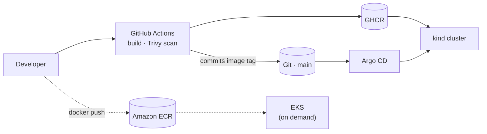

# Harbourline Logistics — Container & Kubernetes Lab

A shipment-tracking application used as the workload for building, breaking and
operating **three Kubernetes environments**: a local `kind` cluster for GitOps and
application work, a **bare-metal multi-node cluster built from scratch with
kubeadm**, and **Amazon EKS**, stood up and torn down per session.

The application is deliberately small. The interesting part is everything around
it — delivery, storage, networking, policy, observability, and what happens when
each of those breaks.

---

## Environments

| | **kind** `harbourline` | **VM cluster** `harbourline-vm` | **AWS** |
|---|---|---|---|
| Built with | `kind` (Docker, WSL2) | **`kubeadm` v1.37, from scratch** | `eksctl` |
| Nodes | 1 control plane + 2 workers | 3 Hyper-V VMs (Ubuntu 24.04) | managed control plane + 2 × t3.medium |
| CNI | kindnet | **Cilium** | VPC CNI |
| Storage | local-path | **Longhorn** (iSCSI, 2 replicas) | EBS CSI (gp3) |
| Load balancing | Ingress via host ports | **MetalLB L2** → Traefik | Classic LB |
| Registry | GHCR (pull secret) | — | **ECR (no pull secret — node IAM role)** |
| Purpose | GitOps, apps, policy, logging | what Kubernetes is *made of* | cloud integration |
| Cost | £0 | £0 | **destroyed after every session** |

Both local clusters live in one kubeconfig, so every command names its context
explicitly — `--context kind-harbourline` or `--context harbourline-vm`.

---

## Delivery pipeline



**No cluster credentials exist in CI.** The pipeline's last step is a commit that
bumps an image tag; Argo CD pulls. A compromised runner cannot reach a cluster.

---

## What this demonstrates

**Delivery and configuration**
Helm chart serving three services from one template · Kustomize base for shared
infrastructure · Argo CD app-of-apps with `selfHeal` (measured: reverts live
drift in under 5 seconds) · sync hooks, including the `PreSync`/`Sync`/`PostSync`
distinction learned by deadlocking a sync · migration from Kustomize to Helm
proven byte-identical with `kubectl diff`

**Availability and scaling**
PodDisruptionBudgets · topology spread constraints · HorizontalPodAutoscaler,
and the conflict between an HPA and GitOps both claiming `spec.replicas` ·
rolling updates and rollback · a Deployment→StatefulSet migration that preserved
the live PersistentVolume

**Networking**
Default-deny **ingress and egress** NetworkPolicies, 10 policies, proven in both
directions · MetalLB L2 failover demonstrated with 96 consecutive 200s through a
handover · Traefik as a single front door with TLS termination, HTTP→HTTPS
redirect and BasicAuth · CoreDNS customisation so pods resolve LAN hostnames

**Storage**
Longhorn across dedicated disks, survived a hard power-off as *Degraded, not
Faulted* · EBS CSI on EKS with `WaitForFirstConsumer` · PV reclaim policies and
what `Retain` is actually for

**Security**
All workloads hardened — non-root, read-only root filesystem, dropped
capabilities, seccomp · **Kyverno** admission policies derived from the project's
own security decisions, with one documented, dated exception · Trivy image, fs
and config scanning in CI · Secret encryption at rest · RBAC

**Observability**
kube-prometheus-stack on both clusters, **one Grafana** reading both · Loki +
Alloy for logs · the `up == 0` query that exposes silently-missing scrape targets

**Cloud**
Full `Developer → image → ECR → EKS → Load Balancer → Application` flow, verified
end to end · IRSA · a `teardown-check.sh` that fails loudly if anything is still
billing

---

## Repository layout

```
api/  web/  reports/     three services, each with a Dockerfile
helm/harbourline/        one chart, three values files
k8s/base/                Kustomize: db, config, ingress, NetworkPolicies
k8s/argocd/              Argo CD Applications (app-of-apps)
k8s/platform/            kind cluster Ingresses (Grafana, Argo CD)
k8s/monitoring/          kube-prometheus-stack, Loki, cross-cluster datasource
k8s/policies/            Kyverno ClusterPolicy
k8s/kind/                CoreDNS customisation (applied by hand, not by Argo)
k8s/vm-cluster/          MetalLB, Longhorn, Traefik, platform Ingresses
k8s/eks/                 eksctl ClusterConfig, app manifests, teardown check
docs/                    architecture, security decisions, runbooks
tools/                   node prep, a kubectl plugin, a network probe
```

---

## Access

| Service | URL | Cluster |
|---|---|---|
| Application | `http://harbourline.localtest.me` | kind |
| Grafana (both clusters) | `http://grafana.localtest.me` | kind |
| Argo CD — applications | `http://argocd.localtest.me` | kind |
| Argo CD — VM platform | `https://argocd.hl.internal` | VM |
| Longhorn | `https://longhorn.hl.internal` | VM |
| Prometheus | `https://prometheus.hl.internal` | VM |

`*.hl.internal` resolves through the workstation's hosts file **and** the kind
cluster's CoreDNS — browsers and pods are different clients and resolve
differently. See [`docs/vm-cluster-access.md`](docs/vm-cluster-access.md).

---

## Running the application locally

```bash
docker network create harbour-net
docker volume create hl-pgdata
docker run -d --name hl-db --network harbour-net \
  -e POSTGRES_PASSWORD=changeme \
  -v hl-pgdata:/var/lib/postgresql/data postgres:16-alpine
docker build -t harbourline/api:latest ./api
docker run -d --name hl-api --network harbour-net -p 8080:8080 \
  --env-file api/db.env harbourline/api:latest
```

`api/db.env` holds credentials and is intentionally not committed — see
`api/db.env.example`.

**API endpoints:** `/health` (liveness, returns hostname and environment) ·
`/config` (non-sensitive effective configuration) · `/dbcheck` (PostgreSQL
connectivity and row count).

---

## Documentation

| Document | What it covers |
|---|---|
| [`architecture.md`](docs/architecture.md) | runtime topology, security boundaries, delivery pipeline |
| [`security-decisions.md`](docs/security-decisions.md) | every hardening decision, and the exceptions **with review dates** |
| [`vm-cluster.md`](docs/vm-cluster.md) | building the kubeadm cluster, and what actually bit |
| [`vm-cluster-access.md`](docs/vm-cluster-access.md) | endpoints, name resolution, credential recovery |
| [`monitoring.md`](docs/monitoring.md) | the stack, and the kubelet x509 failure |
| [`logging.md`](docs/logging.md) | Loki and Alloy; why Loki indexes labels, not content |
| [`triage.md`](docs/triage.md) | diagnosing a broken cluster |
| [`etcd-restore.md`](docs/etcd-restore.md) | snapshot and full restore, performed not just read |
| [`cluster-state-not-in-git.md`](docs/cluster-state-not-in-git.md) | **every imperative change, and why each one is a landmine** |

---

## Known gaps

Kept visible on purpose. A lab that claims to be finished is a lab nobody
operated.

- **The kind cluster still runs ingress-nginx**, which Kubernetes
  [retired in March 2026](https://kubernetes.io/blog/2025/11/11/ingress-nginx-retirement/)
  — no further security patches. The VM cluster has moved to Traefik; kind has not.
- **Prometheus on the VM cluster has no authentication.** Read-only metrics, but
  they leak topology and workload names.
- **TLS on `*.hl.internal` is a self-signed wildcard**, so the Grafana datasource
  runs with `tlsSkipVerify`. cert-manager with a local CA issuer is the fix.
- **`cilium`, `metallb` and `kps` have no values files** — their install-time
  `--set` flags exist only in shell history, which is exactly how a Helm upgrade
  silently reverted a Service and broke a datasource on 16 Oct.
- **Kyverno and Loki are not under Argo CD** — hand-installed, which is the same
  gap they were introduced to close.
- metrics-server runs with `--kubelet-insecure-tls`; the real fix is
  `serverTLSBootstrap` plus CSR approval.
- kubeadm certificate renewal has not been exercised.
