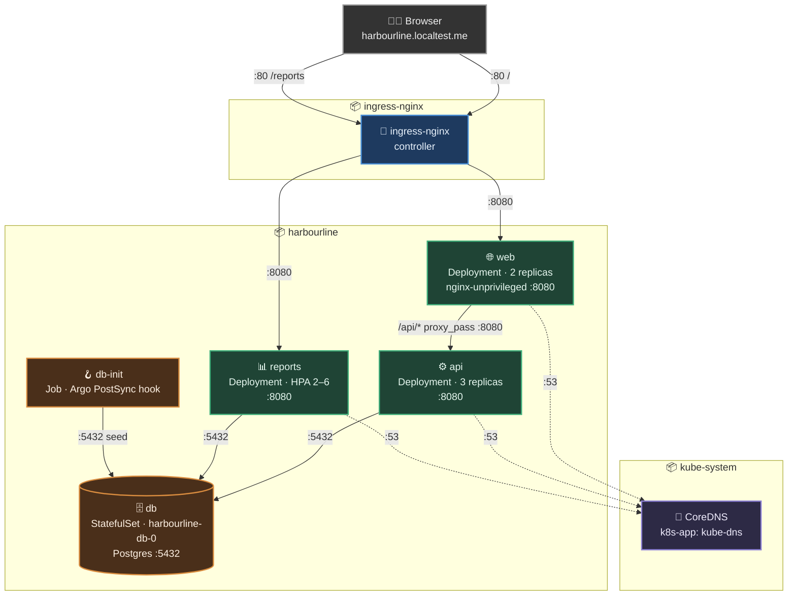
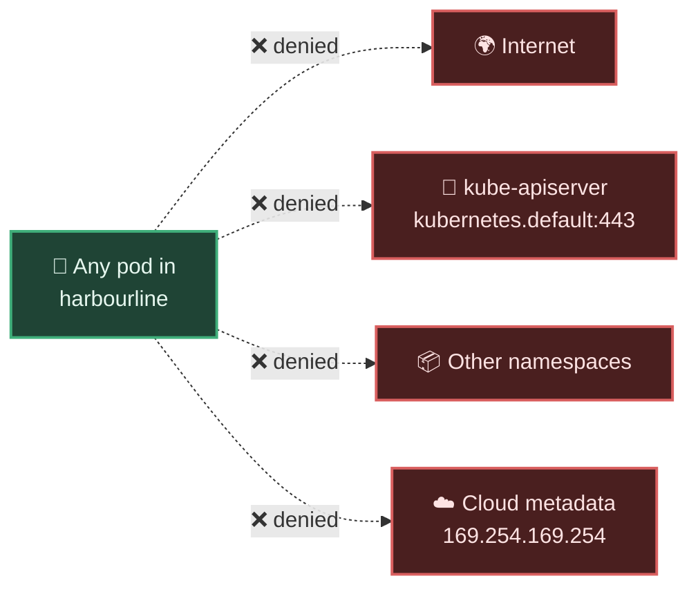
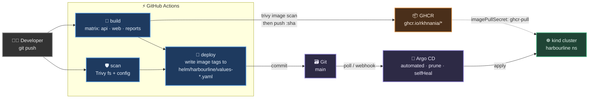

# Harbourline — Architecture

> This document describes the **kind** cluster. The second cluster — three Hyper-V VMs built with kubeadm, running Cilium, MetalLB and Longhorn — is documented in [docs/vm-cluster.md](vm-cluster.md).

Shipment-tracking lab application. Three services plus a database, on a 3-node
`kind` cluster (one control plane, two workers), deployed entirely through GitOps.

- **Cluster:** `harbourline` (kind, Kubernetes v1.37.0), CNI: kindnet
- **Namespace:** `harbourline`
- **Delivery:** GitHub Actions → GHCR → Argo CD (automated, prune, selfHeal)

**[Interactive board (Miro)](https://miro.com/app/board/uXjVEZuyfiI=/)** — the
five sections below as editable shapes: runtime topology, security boundaries,
the NetworkPolicy inventory, the delivery pipeline, and availability controls.
The VM cluster has its own board, linked from [vm-cluster.md](vm-cluster.md).

---

## 1. Runtime topology

Allowed traffic only. Every edge below is explicitly permitted by a
NetworkPolicy; anything not drawn here is denied.

Dotted lines are DNS. They are drawn because **a dependency you cannot resolve
is a dependency you cannot reach** — this is the single most common cause of a
broken egress policy.

> The `web → api` and `api → db` edges do not exist in any Kubernetes object.
> They live in `web/nginx.conf` and a ConfigMap respectively. `tools/kubectl-topology`
> cannot see them; only this hand-maintained diagram records them. Regenerate the
> machine-visible half any time with `kubectl topology -n harbourline`.

---

## 2. Security boundaries

### What is blocked

Why this matters: ingress policy limits who can reach a service. **Egress policy
limits what an attacker can do once already inside a container** — exfiltration,
calling home to a C2 host, scanning the cluster, or reaching the cloud metadata
endpoint to steal instance credentials.

### Policy inventory — `k8s/base/networkpolicies.yaml`

| Policy | Direction | Selects | Permits |
|---|---|---|---|
| `default-deny-ingress` | Ingress | all pods | nothing |
| `allow-ingress-to-web` | Ingress | web | from `ingress-nginx` ns :8080 |
| `allow-ingress-to-reports` | Ingress | reports | from `ingress-nginx` ns :8080 |
| `allow-web-to-api` | Ingress | api | from web :8080 |
| `allow-app-to-db` | Ingress | db | from api, reports, db-init :5432 |
| `default-deny-egress` | Egress | all pods | nothing |
| `allow-dns-egress` | Egress | all pods | to CoreDNS :53 UDP+TCP |
| `allow-web-to-api-egress` | Egress | web | to api :8080 |
| `allow-apps-to-db-egress` | Egress | api, reports | to db :5432 |
| `allow-dbinit-to-db-egress` | Egress | db-init | to db :5432 |

### Three rules that govern all of it

1. **Policies are allow-only.** There is no deny rule. Default-deny is expressed
   as "select everything, permit nothing" — `podSelector: {}` with a `policyTypes`
   entry and no corresponding rule block.
2. **Selection flips the default.** A pod no policy selects accepts and sends
   everything. The moment any policy selects it *for a direction*, everything not
   explicitly allowed in that direction is denied.
3. **A connection needs both halves.** `web → api:8080` requires an egress rule on
   **web** and an ingress rule on **api**. Either one missing and the packet dies.

### Traps worth remembering

| Trap | Detail |
|---|---|
| **AND vs OR** | Multiple selectors as separate list items under `from:`/`to:` mean **OR**. The same selectors as keys inside *one* item mean **AND**. Indentation changes the meaning entirely. |
| **DNS first** | A default-deny egress kills name resolution before it kills anything else. The symptom is `getaddrinfo`/`bad address` in the app, not a network error. |
| **Denial looks like a timeout** | Packets are dropped silently. `curl` exit **28**, not 7. Exit 6 means DNS; exit 7 means refused. |
| **`namespaceSelector`** | Match on `kubernetes.io/metadata.name`, which Kubernetes sets on every namespace automatically. |
| **Probes bypass policy** | kubelet probes originate from the node and keep flowing under default-deny in most CNIs. Convenient, CNI-specific, never design around it. |

### Workload hardening

All five workloads run with `runAsNonRoot`, `allowPrivilegeEscalation: false`,
`readOnlyRootFilesystem`, `capabilities: drop: [ALL]`, and
`seccompProfile: RuntimeDefault`. One documented exception (KSV-0014 on Postgres)
is recorded in `docs/security-decisions.md`. Secrets are encrypted at rest.

---

## 3. Delivery pipeline

**The pipeline holds no cluster credentials.** CI never runs `kubectl`. It builds,
scans, pushes, and commits a tag change; Argo CD pulls. A compromised CI runner
cannot reach the cluster.

### Argo CD applications

| Application | Source | Contents |
|---|---|---|
| `root` | `k8s/argocd/apps/` | app-of-apps |
| `harbourline` | Kustomize `k8s/base/` | ConfigMap, Ingress, db StatefulSet, db-init hook, **NetworkPolicies** |
| `harbourline-api` | Helm `values-api.yaml` | Deployment, Service, PDB |
| `harbourline-web` | Helm `values-web.yaml` | Deployment, Service, PDB |
| `harbourline-reports` | Helm `values-reports.yaml` | Deployment, Service, PDB, **HPA** |
| `platform` | `k8s/platform/` | ingress-nginx, monitoring |

---

## 4. Availability controls

| Control | Where | Effect |
|---|---|---|
| **PodDisruptionBudget** | all three services | blocks a drain from evicting the last replica |
| **topologySpreadConstraints** | all three services | `maxSkew: 1` across nodes, with `nodeTaintsPolicy: Honor` and `nodeAffinityPolicy: Honor` so the tainted control plane is not counted as an empty domain |
| **HPA** | reports only | 2–6 replicas at 50% CPU. `replicas` is omitted from the chart when an HPA exists, so selfHeal does not fight the autoscaler |
| **Rolling updates** | all three | `maxSurge` / `maxUnavailable`, with ReplicaSet history for `rollout undo` |

Known gap: neither spread nor a PDB helps when a node dies outright, and nothing
rebalances pods afterwards — `rollout restart` does **not** do it. Deleting pods
one at a time does; the descheduler is the proper fix and is not installed.

---

## 5. Observability

| Tool | Access | Purpose |
|---|---|---|
| Prometheus + Grafana | `grafana.localtest.me` | metrics, dashboards |
| Headlamp | `localhost:8081` | cluster web UI |
| Argo CD | `argocd.localtest.me` | sync and health |

Gap: **no log aggregation.** Diagnosing a crashed container still depends on
`kubectl logs --previous` before it is garbage-collected. Loki is the planned fix.

---

## Changelog

### 2026-10-12
- **Ingress NetworkPolicies** — default-deny plus four explicit allows. Verified
  in both directions: an unlabelled probe pod went from `api 200 / reports 200 /
  db OPEN` to `api 000 / reports 000 / db closed` with the site still serving 200.
- **Egress NetworkPolicies** — default-deny plus DNS and a per-service allowlist.
  Outbound internet and kube-apiserver access from the namespace are now blocked.
- **Web UI redesign** — inline SVG anchor/wave logo, gradient header, stat tiles
  computed client-side, status pills, dark mode via `prefers-color-scheme`,
  15-second auto-refresh, HTML-escaped API output.
- **Finding, not yet fixed:** web's readiness probe fetches a static file, so it
  returned 200 for the entire period the site could not load data. A probe on `/`
  proves nginx is alive, not that the service works. Deepening it would make an
  api outage mark every web pod unready — deep health checks versus blast radius.
