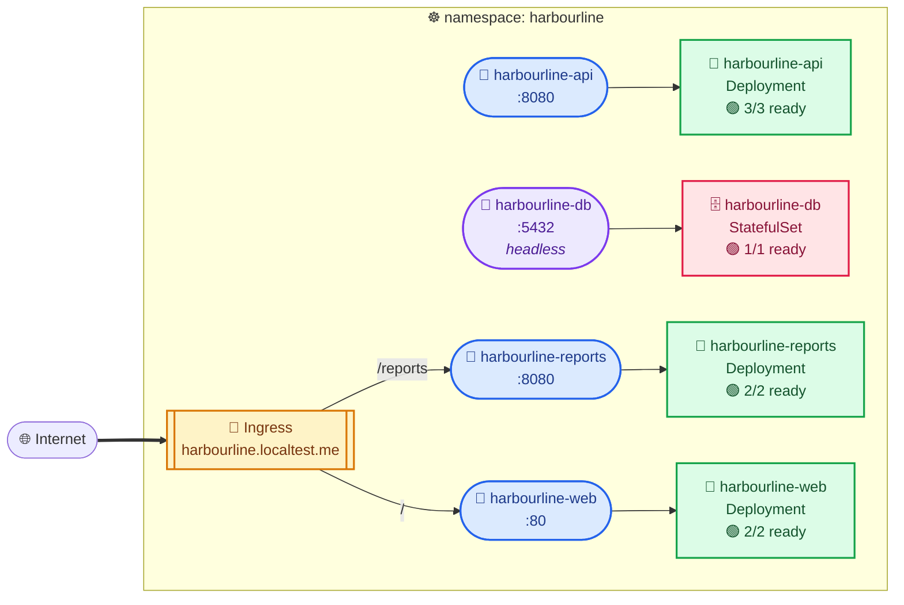
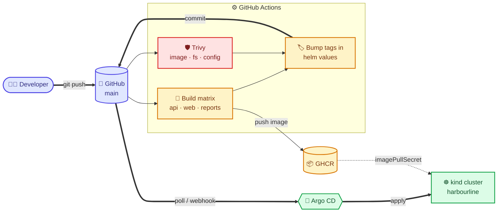

# 🏗️ Architecture

## ☸️ Runtime topology

Generated from the **live cluster** by [`tools/kubectl-topology`](../tools/kubectl-topology) — a kubectl plugin that matches Service selectors against pod-template labels, so every edge shown is one the cluster itself would route.

> ⚠️ **What this diagram cannot show.** There are no `web → api` or `api → db` edges, because those dependencies live in `nginx.conf` and a ConfigMap — not in any Kubernetes object. The API server does not know they exist. Observing them needs eBPF tooling or a service mesh.

## 🚚 Delivery pipeline

**No cluster credentials exist in CI.** The pipeline only ever writes to Git; Argo CD pulls. That is the security property GitOps buys you.
