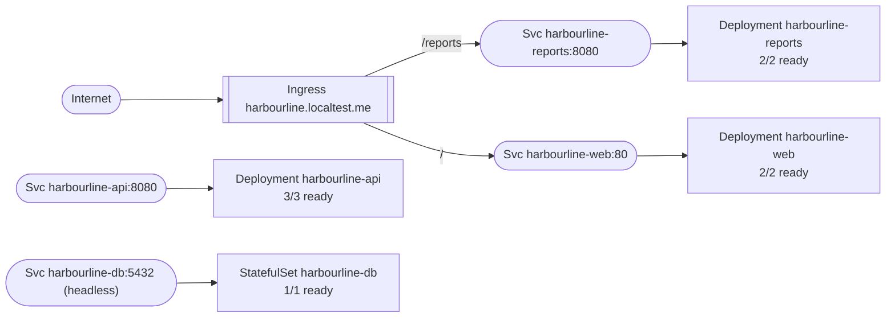
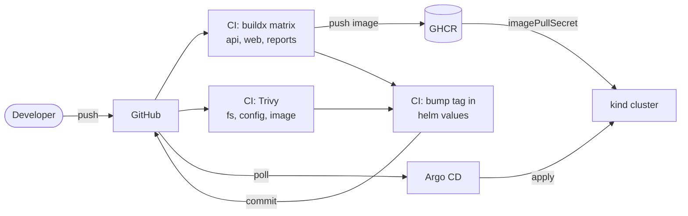

# Architecture

## Runtime topology

Generated from the live cluster with `tools/kubectl-topology`:

> Service-to-service edges (web -> api, api -> db) are deliberately absent.
> They exist in nginx.conf and the ConfigMap, not in any Kubernetes object,
> so the API server cannot report them.

## Delivery pipeline

